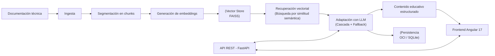

# NuevaMente — Sistema Inteligente de Adaptación y Generación de Contenido Educativo


**NuevaMente** transforma documentación técnica en materiales educativos claros y didácticos, permitiendo que los equipos aceleren el aprendizaje a partir del conocimiento técnico ya existente.

## Rutas de lectura rápida

- **Para estudiantes y primeros pasos:** Dirígete a la sección [4. Acceso al proyecto / Instalación](#4-acceso-al-proyecto--instalación) o consulta directamente el tutorial guiado en [docs/02-Instalacion/Uso_Local.md](docs/02-Instalacion/Uso_Local.md) para levantar el entorno en tu máquina paso a paso.
- **Para desarrolladores senior y evaluadores técnicos:** Revisa la [3. Arquitectura y tecnologías](#3-arquitectura-y-tecnologías) y la sección [7. Documentación detallada (Marco Diátaxis)](#7-documentación-detallada-marco-diátaxis) para examinar contratos de API, diseño RAG, cascada con fallback y almacenamiento.

## Índice

- [1. Descripción del proyecto](#1-descripción-del-proyecto)
- [2. Características principales](#2-características-principales)
- [3. Arquitectura y tecnologías](#3-arquitectura-y-tecnologías)
- [4. Acceso al proyecto / Instalación](#4-acceso-al-proyecto--instalación)
- [5. Uso](#5-uso)
- [6. Estructura del proyecto](#6-estructura-del-proyecto)
- [7. Documentación detallada (Marco Diátaxis)](#7-documentación-detallada-marco-diátaxis)
- [8. Próximos pasos o futuras implementaciones](#8-próximos-pasos-o-futuras-implementaciones)
- [9. Contribución](#9-contribución)
- [10. Licencia](#10-licencia)

## 1. Descripción del proyecto

**Problema:** Las organizaciones acumulan manuales, guías, especificaciones y otra documentación técnica extensa, pero este conocimiento suele ser difícil de asimilar para quienes están en proceso de formación u onboarding. Ese material, por su densidad y formato, queda infrautilizado.

**Solución:** NuevaMente toma esa documentación existente y la adapta a contenido educativo estructurado, ajustado al perfil y nivel de detalle, sin perder precisión ni fidelidad a la fuente.

**Valor:** Reduce el tiempo de aprendizaje, facilita la transferencia de conocimiento dentro del equipo y reutiliza activos técnicos ya existentes para generar material formativo útil y listo para aplicar.

**Público objetivo:** Equipos de formación, producto, desarrollo y documentación que necesitan convertir activos técnicos en materiales de aprendizaje para acelerar la adopción de tecnologías, herramientas o procesos.

**Enfoque actual:** El flujo se basa en **recuperación vectorial + adaptación con LLM**. Se obtiene contexto relevante mediante búsqueda por similitud semántica (vectorial) y se adapta ese contexto al formato educativo mediante un LLM. El sistema está diseñado para priorizar la fidelidad a las fuentes y cuenta con **cascada de proveedores con fallback** para mejorar su robustez.

**Más información:** [docs/01-Arquitectura/Arquitectura.md](docs/01-Arquitectura/Arquitectura.md)

## 2. Características principales

- **Adaptación educativa flexible:** Soporta múltiples formatos (Flashcards, Quiz, Tutorial, Resumen Ejecutivo, Guión de Clase) según el objetivo de aprendizaje.
- **Recuperación vectorial:** Búsqueda semántica por similitud sobre **FAISS** (local) con control total sobre los datos.
- **Adaptación guiada por prompts:** Prompts externos para ajustar tono, formato y nivel de detalle sin modificar el código.
- **Robustez con fallback:** Implementación preparada para **cascada de modelos con fallback** entre proveedores, lo que permite mantener la disponibilidad ante errores o límites.
- **API REST organizada (FastAPI):** Endpoints claros para ingesta, recuperación y adaptación.
- **Interfaz web (Angular 17):** UI principal para probar y visualizar el flujo completo.
- **Alternativa básica para pruebas rápidas (Gradio):** Incluye una interfaz ligera basada en **Gradio** para validar ingesta y generación sin levantar el frontend completo.

**Más información:** [docs/01-Arquitectura/Componentes.md](docs/01-Arquitectura/Componentes.md)

## 3. Arquitectura y tecnologías



- **Backend:** FastAPI (Python >= 3.12), gestionado con [uv](https://github.com/astral-sh/uv).
- **Frontend:** Angular 17 (standalone), servido con nginx.
- **Vector Store:** FAISS (local).
- **Embeddings:** Gemini, Jina y modelo local (`intfloat/multilingual-e5-base`).
- **LLM:** Google Gemini (modelo principal), con soporte para **cascada y fallback** entre proveedores.
- **Orquestación:** LangGraph con Multi-Agent.
- **Almacenamiento:** OCI Object Storage (Always Free) + SQLite local para metadatos, alternativa Supabase, o local.

**Más información:** [docs/01-Arquitectura/Tecnologias.md](docs/01-Arquitectura/Tecnologias.md)

## 4. Acceso al proyecto / Instalación

### Pasos rápidos:

1. Clonar el repositorio.
2. Configurar el backend con `uv`.
3. Configurar el frontend con `npm`.
4. Crear `backend/.env` a partir de `backend/.env.example`.
5. Ejecutar backend y frontend.

> **Tutorial paso a paso para estudiantes:** Consulta [docs/02-Instalacion/Uso_Local.md](docs/02-Instalacion/Uso_Local.md) para la guía detallada con verificación de servicios, solución de problemas y comandos exactos.

## 5. Uso

- **Backend (desarrollo):** Desde `backend/`
  ```bash
  uv run --with email-validator --with genanki python main.py
  ```
- **Frontend (desarrollo):** Desde `frontend/`
  ```bash
  npm install && npm start  # http://localhost:4200
  ```
- **Alternativa básica para pruebas rápidas (Gradio):** Desde `backend/`
  ```bash
  uv run python ../frontend_gradio/app_gradio.py
  ```
  > `frontend_gradio/` es una **alternativa básica** (UI con Gradio) pensada para validaciones puntuales del flujo de ingesta/adaptación, sin necesidad de levantar la aplicación Angular completa.

**Más información:** [docs/02-Instalacion/Uso_Local.md](docs/02-Instalacion/Uso_Local.md) | [docs/04-Documentacion/backend/ingestion/API_de_Ingesta.md](docs/04-Documentacion/backend/ingestion/API_de_Ingesta.md)

## 6. Estructura del proyecto

```text
nueva-mente/
├── backend/            # API FastAPI (Python >= 3.12)
│   ├── app/             # Núcleo: api/, core/, services/, prompts/, schemas/, infrastructure...
│   ├── migrations/      # Migraciones SQL (aplicadas manualmente en Supabase)
│   ├── scripts/         # Scripts de apoyo y diagnóstico
│   └── tests/           # Pruebas del backend (pytest) y scripts en tests/manual/
├── frontend/           # Aplicación Angular 17 (standalone). UI principal
├── frontend_gradio/    # UI alternativa básica (Gradio) para pruebas rápidas
├── docs/               # Documentación detallada del proyecto
├── .gitignore          # Archivo de configuración de gitignore
└── .gitleaks.toml      # Configuración de detección de secretos
```

**Más información:** [docs/03-Estructura/Estructura_de_Archivos.md](docs/03-Estructura/Estructura_de_Archivos.md)

## 7. Documentación detallada (Marco Diátaxis)

La documentación técnica del proyecto se organiza bajo el sistema de 4 cuadrantes de documentación, adaptado para facilitar el recorrido tanto a perfiles que se inician como a perfiles senior:

### 1. Tutoriales (Orientados al aprendizaje práctico)
Paso a paso guiado para poner en marcha el proyecto desde cero:
- [Tutorial de Uso Local](docs/02-Instalacion/Uso_Local.md): Instalación de dependencias, configuración mínima y primera ejecución integral del sistema.

### 2. Guías Prácticas / How-To (Orientadas a tareas específicas)
Instrucciones paso a paso para resolver configuraciones puntuales y despliegue:
- [Despliegue con Docker y Docker Compose en OCI](docs/02-Instalacion/Despliegue_Docker_OCI.md): Despliegue contenerizado del frontend y backend en Compute VM.
- [Creación de Instancia en Oracle Cloud (OCI Always Free)](docs/02-Instalacion/Creacion_de_Instancia_OCI.md): Configuración de máquina virtual, VCN, seguridad e IP pública.
- [Configuración de LLMs y Proveedores](docs/02-Instalacion/Configuracion_de_LLMs.md): Credenciales de Gemini, Groq, OpenRouter y configuración de cascada.
- [Configuración de Almacenamiento](docs/02-Instalacion/Configuracion_de_Storages.md): Selección de OCI Object Storage, Supabase o almacenamiento local.

### 3. Referencia (Orientada a la información técnica precisa)
Especificaciones formales, contratos de datos y catálogos de componentes:
- [API REST de Ingesta](docs/04-Documentacion/backend/ingestion/API_de_Ingesta.md): Endpoints, payloads JSON, parámetros de consulta y códigos de respuesta.
- [Estructura de Archivos del Repositorio](docs/03-Estructura/Estructura_de_Archivos.md): Árbol detallado de módulos, directorios y responsabilidades.
- [Almacenamiento en OCI Object Storage](docs/04-Documentacion/backend/storage/Almacenamiento_OCI.md): Métodos y cliente de integración con OCI.
- [Almacenamiento en Supabase](docs/04-Documentacion/backend/storage/Almacenamiento_Supabase.md): Esquemas de tablas relacionales y persistencia de metadatos.
- [Frontend Angular](docs/04-Documentacion/frontend/Angular.md): Arquitectura de componentes, servicios y consumo de la API.
- [Frontend de Pruebas Gradio](docs/04-Documentacion/frontend/Gradio.md): Interfaz rápida para pruebas manuales.

### 4. Explicación (Orientada a la comprensión conceptual y arquitectura)
Análisis de diseño, fundamentos de las decisiones tomadas y flujo del sistema:
- [Arquitectura General del Sistema](docs/01-Arquitectura/Arquitectura.md): Filosofía de diseño, flujo RAG y modelo de fallback.
- [Componentes del Sistema](docs/01-Arquitectura/Componentes.md): Desglose funcional de subsistemas de ingesta, adaptación y entrega.
- [Tecnologías y Decisiones de Stack](docs/01-Arquitectura/Tecnologias.md): Justificación técnica de herramientas seleccionadas.
- [Arquitectura del Backend](docs/04-Documentacion/backend/architecture/Arquitectura_del_Backend.md): Capas del backend, inyección de dependencias y patrones aplicados.
- [Flujo de Servicios Backend](docs/04-Documentacion/backend/architecture/Flujo_de_Servicios.md): Secuencia completa desde la solicitud HTTP hasta la respuesta generada.
- [Ingesta y Segmentación (Chunking)](docs/04-Documentacion/backend/ingestion/Ingesta_y_Chunking.md): Criterios de fragmentación y preparación de documentos.
- [Generación de Embeddings](docs/04-Documentacion/backend/embeddings/Embeddings.md): Modelos de vectorización y consideraciones multilingües.
- [Almacén Vectorial FAISS](docs/04-Documentacion/backend/embeddings/Almacen_Vectorial.md): Indexación, métricas de distancia y persistencia vectorial.
- [Estrategia de Recuperación](docs/04-Documentacion/backend/retrieval/Recuperacion.md): Búsqueda semántica por similitud y umbrales de relevancia.
- [Reranking y Filtrado](docs/04-Documentacion/backend/retrieval/Reranking.md): Mecanismos de reordenamiento para optimizar el contexto entregado al LLM.

## 8. Próximos pasos o futuras implementaciones

- **Solicitud de Temas o Secciones Específicas**: Adaptar el contenido de un tema o sección específico. 

## 9. Contribución

Este proyecto se desarrolla de forma **interna por el Equipo 18 del G10**. Para mantener coherencia, calidad y trazabilidad, se recomienda seguir estas directrices:

- Nombres

## 10. Licencia

Proyecto educativo. Ver detalles en [LICENSE](LICENSE).