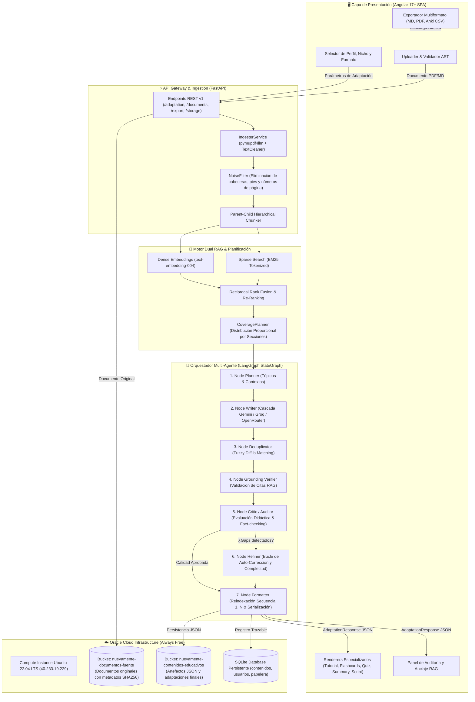
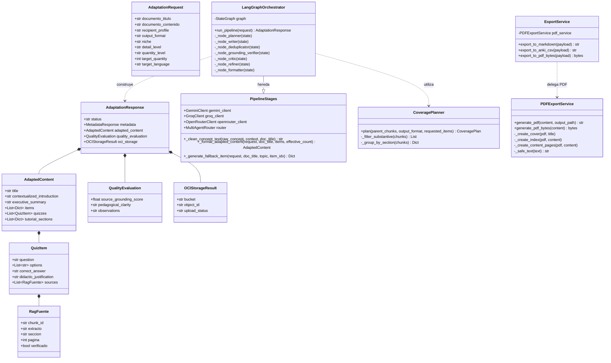
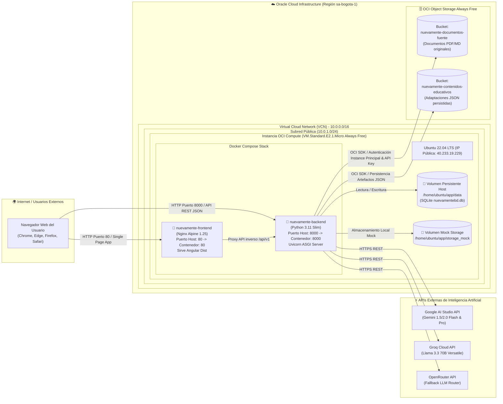
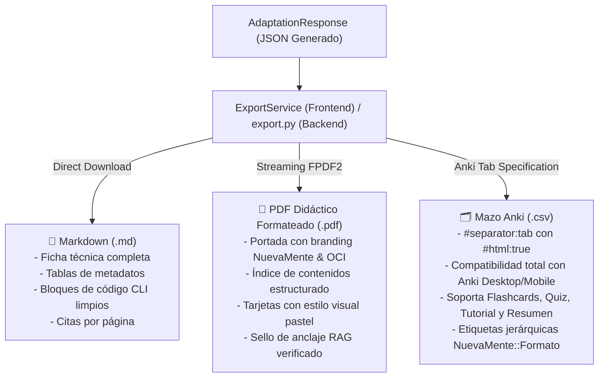

# 🎓 NuevaMente — Sistema Inteligente de Adaptación y Generación de Contenido Educativo

> **Programa ONE (Oracle Next Education) & Alura — Hackathon ONE G10**  
> **Equipo 18 | Proyecto 1: Adaptación de Contenido Técnico con IA Generativa, Graph RAG y OCI Always Free**  
> *Despliegue en Producción: Oracle Cloud Infrastructure (OCI Compute Instance Ubuntu 22.04 LTS)*

[](https://github.com/No-Country-simulation/G10-LATAM-Equipo-18-NuevaMente)
[](https://fastapi.tiangolo.com/)
[](https://angular.io/)
[](https://cloud.oracle.com/)
[](https://ai.google.dev/)
[](https://www.docker.com/)
[](https://docs.pytest.org/)

---

## 📑 Tabla de Contenidos
1. [Descripción Ejecutiva](#-descripción-ejecutiva)
2. [Arquitectura General del Sistema](#-arquitectura-general-del-sistema)
3. [Diagrama de Clases y Modelo de Dominio](#-diagrama-de-clases-y-modelo-de-dominio)
4. [Diagrama de Despliegue en Oracle Cloud Infrastructure (OCI)](#-diagrama-de-despliegue-en-oracle-cloud-infrastructure-oci)
5. [Arquitectura Interna del Backend](#-arquitectura-interna-del-backend)
   - [Motor de Ingestión y Limpieza AST](#1-motor-de-ingestión-y-limpieza-ast)
   - [Dual Indexing: RAG Híbrido y Graph RAG](#2-dual-indexing-rag-híbrido-y-graph-rag)
   - [Orquestador Multi-Agente LangGraph (7 Nodos)](#3-orquestador-multi-agente-langgraph-7-nodos)
   - [Cascada de LLMs y Circuit Breakers](#4-cascada-de-llms-y-circuit-breakers)
6. [Arquitectura Interna del Frontend (Angular 17+)](#-arquitectura-interna-del-frontend-angular-17)
   - [Diseño y Filosofía Standalone](#1-diseño-y-filosofía-standalone)
   - [Jerarquía y Funcionalidad de Componentes](#2-jerarquía-y-funcionalidad-de-componentes)
   - [Conectividad y Flujo de Datos Reactivo con Signals](#3-conectividad-y-flujo-de-datos-reactivo-con-signals)
7. [Exportación Multiformato de Alta Fidelidad](#-exportación-multiformato-de-alta-fidelidad)
8. [Trazabilidad y Taxonomía en OCI Object Storage](#-trazabilidad-y-taxonomía-en-oci-object-storage)
9. [Guía de Instalación, Pruebas y Despliegue](#-guía-de-instalación-pruebas-y-despliegue)

---

## 📄 Descripción Ejecutiva

**NuevaMente** es una plataforma de software de nivel industrial diseñada para resolver el problema de la sobrecarga y complejidad cognitiva en la documentación técnica. Transforma manuales de ingeniería, guías de arquitectura cloud, especificaciones de software y artículos científicos en **materiales pedagógicos interactivos y verificables**, adaptados milimétricamente al perfil cognitivo del lector.

### ¿Qué problema resuelve?
* **Sobrecarga técnica:** Ingenieros junior, decisores de negocio o arquitectos requieren diferentes niveles de abstracción sobre un mismo documento.
* **Alucinaciones en LLMs convencionales:** Los modelos de lenguaje tradicionales inventan parámetros de configuración o comandos inexistentes.
* **Falta de trazabilidad:** Es imposible auditar de qué página o sección de la fuente original provino una instrucción técnica.

### Solución Implementada:
1. **Hiper-personalización:** Adapta tono, profundidad y ejemplos para 4 perfiles técnicos (Principiante, Desarrollador Junior/Mid, Líder Técnico/Arquitecto, Ejecutivo) y 5 nichos (Fintech, Salud, E-commerce, Cloud, General).
2. **5 Formatos Pedagógicos:** Guías Paso a Paso (Tutorial), Tarjetas de Memorización Activa (Flashcards), Cuestionarios con Justificación Didáctica (Quiz), Resumen Ejecutivo (TL;DR), y Guiones de Clase Técnica.
3. **Fidelidad y Anclaje RAG Verificado:** Cada ítem emitido contiene citas de origen con página, sección y fragmento literal. Un agente auditor (Crítico) evalúa la veracidad del material antes de serializarlo.

---

## 🏗️ Arquitectura General del Sistema

El flujo de procesamiento sigue un patrón de arquitectura por capas desacopladas, asegurando independencia entre el frontend reactivo, el backend FastAPI, los agentes de LangGraph y los servicios de Oracle Cloud:



---

## 🧬 Diagrama de Clases y Modelo de Dominio

La lógica de negocio y las estructuras de datos están fuertemente tipadas en Pydantic v2 (Python) e interfaces estrictas en TypeScript:



---

## 🌐 Diagrama de Despliegue en Oracle Cloud Infrastructure (OCI)

El sistema opera en producción dentro del tier **OCI Always Free**, distribuido mediante contenedores Docker con reinicio automático y volúmenes de datos montados:



---

## ⚙️ Arquitectura Interna del Backend

El backend está desarrollado sobre **FastAPI** y **Python 3.11+**, siguiendo principios de alta cohesión, bajo acoplamiento y control estricto de concurrencia y rate limiting.

### 1. Motor de Ingestión y Limpieza AST
* **Extracción Multi-Formato:** Utiliza `pymupdf4llm` para documentos PDF convirtiéndolos a Markdown estructurado con detección de tablas e imágenes, y `pypdf` como extractor de texto de reserva.
* **Limpieza de Ruido (`TextCleaner`):** Remueve artefactos binarios de PDF (`stream ... endstream`, `xref`, `startxref`), repara ligaduras rotas del OCR (e.g. `configuración` → `configuración`), y elimina encabezados y pies de página recurrentes.
* **Eliminación de Falsos Títulos:** Filtra números de página aislados (`53 de 363`, `página 12`) y numerales romanos (`# **VII.**`) para impedir que se conviertan artificialmente en secciones del contenido.
* **Chunking Jerárquico Parent-Child:** Divide el documento en bloques padre contextuales (~1000 tokens) y bloques hijo finos (~200 tokens), preservando la ruta jerárquica de encabezados (`breadcrumb: "Doc > Módulo > Sección"`).

### 2. Dual Indexing: RAG Híbrido y Graph RAG
* **Búsqueda Densa:** Embeddings generados mediante `text-embedding-004` de Google Gemini (768 dimensiones).
* **Búsqueda Dispersa (Sparse):** Motor BM25 optimizado para coincidencias exactas de términos técnicos, nombres de funciones, comandos y acrónimos.
* **Fusión de Rango Recíproco (RRF):** Pondera los resultados de ambos métodos para obtener pasajes con relevancia semántica y léxica simultánea.
* **Graph RAG (Grafo de Prerrequisitos):** Modela entidades técnicas en un Grafo Acíclico Dirigido (DAG con `networkx`), identificando la secuencia natural de aprendizaje.
* **CoveragePlanner (Planificador de Cobertura):** Analiza el volumen de contenido real y distribuye los ítems solicitados entre las diferentes secciones del documento, evitando la concentración del 100% de la generación en la primera página.

### 3. Orquestador Multi-Agente LangGraph (7 Nodos)
El núcleo del pipeline ejecuta un StateGraph compilado con **LangGraph**:
1. **Node 1: Planner:** Genera tópicos pedagógicos limpios a partir del `CoveragePlan`.
2. **Node 2: Writer (Redactor):** Invoca los modelos de lenguaje usando prompts estructurados por formato (`tutorial.md`, `flashcards.md`, `quiz.md`, etc.).
3. **Node 3: Deduplicator:** Aplica algoritmos de coincidencia difusa (`difflib.SequenceMatcher` con umbral 0.88) para erradicar conceptos repetidos.
4. **Node 4: Grounding Verifier (Verificador de Anclaje):** Valida que cada extracto citado exista en los fragmentos inyectados por el RAG.
5. **Node 5: Critic / Auditor:** Analiza la claridad didáctica según el perfil del usuario y calcula el `source_grounding_score`.
6. **Node 6: Refiner (Bucle Condicional):** Si el Crítico detecta que faltan elementos o se descartaron ítems no anclados, activa un bucle de completitud dirigida.
7. **Node 7: Formatter & Storage:**
   - **Re-indexación Secuencial:** Garantiza numeración estricta 1..N en pasos de tutoriales (`paso: 1, 2, 3...`) y escenas de guiones (`escena: 1, 2, 3...`).
   - **Sanitización de Títulos:** Elimina prefijos dobles como `Paso 1: Paso 1:` y limpia cualquier residuo de formato Markdown.
   - **Persistencia OCI:** Almacena el artefacto en el bucket correspondiente con metadatos de trazabilidad.

### 4. Cascada de LLMs y Circuit Breakers
Implementada en `MultiAgentRouter` y `LLMGuard`:
* **Orden de Cascada Dinámico:** Intenta resolver con Google Gemini (`gemini-2.0-flash` / `gemini-1.5-pro`); si el proveedor entra en rate-limit (HTTP 429) o error 5xx, conmuta automáticamente a Groq (`llama-3.3-70b-versatile`) y posteriormente a OpenRouter.
* **Circuit Breaker:** Bloquea temporalmente modelos con fallas consecutivas para evitar latencia innecesaria.
* **Generador Heurístico Determinista:** En caso de caída total de proveedores de red, el sistema genera ítems pedagógicos válidos construidos a partir del contexto RAG directo, garantizando disponibilidad del 100%.

---

## 💻 Arquitectura Interna del Frontend (Angular 17+)

El frontend fue diseñado con **Angular 17+** bajo arquitectura de componentes **Standalone**, aprovechando el nuevo paradigma de reactividad con **Signals** (`signal`, `computed`, `effect`) sin depender de zone.js ni librerías pesadas.

### 1. Diseño y Filosofía Standalone
* **Cero NgModules:** Todos los componentes, directivas y pipes son autónomos (`standalone: true`), facilitando lazy loading y pruebas aisladas.
* **Diseño Glassmorphic & Sistema de Diseño Unificado:** Paleta moderna con soporte de modo claro/oscuro mediante variables CSS nativas (`--bg-app`, `--bg-surface`, `--primary: #4F46E5`, `--border-subtle`).
* **Bundle Ligero:** Bundle de producción altamente optimizado (~149 kB comprimido).

### 2. Jerarquía y Funcionalidad de Componentes

```
frontend/src/app/
├── core/
│   ├── api/                     # Interfaces HTTP y Clientes REST (HttpNuevamenteApiService)
│   ├── models/                  # Interfaces de datos TypeScript (AdaptationResponse, etc.)
│   ├── services/                # Servicios Core (StateService, ExportService, ApiService, ThemeService)
│   └── store/                   # Manejador de estado de autenticación (AuthStore)
├── features/
│   ├── workspace/               # Espacio de trabajo principal y generación
│   │   ├── workspace.component  # Coordinador central del flujo RAG
│   │   ├── generation-loader    # Barra de progreso y pasos del pipeline
│   │   ├── pipeline-progress    # Indicador de estado de los nodos de LangGraph
│   │   ├── quality-panel        # Indicador visual de score y auditoría RAG
│   │   ├── sello-confianza      # Sello visual de confianza pedagógica
│   │   ├── json-drawer          # Visor e inspeccionador de JSON Schema en vivo
│   │   ├── sources-drawer       # Visor lateral de citas, fragmentos y páginas fuente
│   │   └── renderers/           # Visualizadores especializados por formato:
│   │       ├── tutorial-renderer.component.ts    # Timeline interactivo, copiado de código CLI, checklist
│   │       ├── flashcards-renderer.component.ts  # Tarjetas 3D con giro, autoevaluación y pistas
│   │       ├── quiz-renderer.component.ts        # Quiz interactivo con feedback instantáneo y justificaciones
│   │       ├── summary-renderer.component.ts     # Puntos clave con tarjetas de impacto de negocio
│   │       └── script-renderer.component.ts      # Guion de clase con tiempos, locución y apoyo visual
│   ├── library/                 # Biblioteca de contenidos guardados con búsqueda, filtros y exportación
│   ├── trash/                   # Papelera de reciclaje con restauración y purga en 30 días
│   ├── documents/               # Gestor de documentos fuente cargados en OCI
│   ├── compare/                 # Comparador de versiones y análisis diferencial
│   └── auth/                    # Login, registro y flujo de autenticación
```

### 3. Conectividad y Flujo de Datos Reactivo con Signals
* **`StateService`:** Administra el estado global de la aplicación (documento activo, respuesta de adaptación actual, lista de proyectos recientes y papelera).
* **Reactividad Pura con Signals:**
  ```typescript
  // Ejemplo de estado reactivo en WorkspaceComponent:
  currentResponse = computed(() => this.stateService.currentResponse());
  hasActiveResult = computed(() => !!this.currentResponse());
  ```
* **Comunicación con el Backend:** El cliente `HttpNuevamenteApiService` realiza llamadas HTTP tipadas a `/api/v1/adaptation/adapt-interactive` mediante `HttpClient`, manejando errores de red y serialización automáticamente.

---

## 📦 Exportación Multiformato de Alta Fidelidad

Cumpliendo con los estándares de software educativo y accesibilidad, el sistema provee **descarga directa en 3 formatos**:



1. **Markdown Didáctico (`.md`):**
   * Encabezado con ficha técnica pedagógica (perfil, formato, tiempo, RAG score).
   * Formateo compatible con GitHub, Obsidian y Notion.
   * Citas de páginas y secciones explícitas.
2. **PDF Didáctico Formateado (`.pdf`):**
   * Generado en backend con `fpdf2` mediante el endpoint `POST /api/v1/export/pdf` y cliente Angular con fallback a vista previa de impresión nativa.
   * Incluye carátula OCI, tabla de contenidos, cajas de advertencia de seguridad y paneles de justificación pedagógica.
3. **Mazo Anki Compatible (`.csv`):**
   * Codificación UTF-8 con BOM (`\ufeff`) para compatibilidad perfecta con Excel, Anki Desktop, AnkiDroid y AnkiMobile.
   * Permite importar en 1 clic tarjetas de estudio de Flashcards, preguntas de Quiz, pasos de Tutorial o resúmenes ejecutivos.

---

## 🗄️ Trazabilidad y Taxonomía en OCI Object Storage

La persistencia en **Oracle Cloud Infrastructure Object Storage** sigue estrictos estándares de trazabilidad y gobernanza de datos:

### Taxonomía de Nombres de Objeto:
* **Documentos Fuente Originales:**
  ```
  Bucket: nuevamente-documentos-fuente
  Ruta:   usuarios/{user_id}/documentos/{slug_fuente}_{YYYYMMDD}_{hash8}/{nombre_archivo_original}
  Ejemplo: usuarios/anonimo/documentos/manual_seguridad_20261017_0aa5d59e/manual_seguridad.pdf
  ```
* **Contenidos Educativos Generados:**
  ```
  Bucket: nuevamente-contenidos-educativos
  Ruta:   usuarios/{user_id}/contenidos/{slug_fuente}_v{version}.json
  Ejemplo: usuarios/anonimo/contenidos/manual_seguridad_v1.json
  ```

### Metadatos Inyectados (`opc-meta-*`):
Cada objeto almacenado en OCI lleva metadatos personalizados para auditoría:
* `opc-meta-original-filename`: Nombre original del archivo subido por el usuario.
* `opc-meta-user-id`: Identificador del usuario propietario.
* `opc-meta-sha256`: Hash criptográfico SHA-256 para verificación de integridad.
* `opc-meta-trace-id`: Identificador único de trazabilidad de la ejecución del pipeline.

---

## 🚀 Guía de Instalación, Pruebas y Despliegue

### 1. Requisitos Previos
* Python 3.11+
* Node.js 18+ y npm 9+
* Docker y Docker Compose (opcional para ejecución en contenedores)
* Clave de API de Google Gemini (obtenida en [Google AI Studio](https://aistudio.google.com/))

### 2. Configuración de Variables de Entorno (`.env`)
Crear un archivo `.env` en la raíz de `backend/` basado en `.env.example`:
```env
# Inteligencia Artificial
GEMINI_API_KEY=tu_api_key_de_gemini
GROQ_API_KEY=tu_api_key_de_groq_opcional
OPENROUTER_API_KEY=tu_api_key_openrouter_opcional

# Oracle Cloud Infrastructure (OCI)
OCI_USER=ocid1.user.oc1..ejemplo
OCI_FINGERPRINT=aa:bb:cc:dd:...
OCI_KEY_FILE=/ruta/a/tu/clave.pem
OCI_TENANCY=ocid1.tenancy.oc1..ejemplo
OCI_REGION=sa-bogota-1
OCI_COMPARTMENT_ID=ocid1.compartment.oc1..ejemplo
OCI_BUCKET_DOCS=nuevamente-documentos-fuente
OCI_BUCKET_CONTENTS=nuevamente-contenidos-educativos

# Base de datos y seguridad
DATABASE_URL=sqlite:///./data/nuevamentebd.db
JWT_SECRET_KEY=clave_secreta_para_firmar_tokens
```

### 3. Ejecución Local en Modo Desarrollo

#### Backend (FastAPI):
```bash
cd backend
python -m venv venv
# En Windows:
venv\Scripts\activate
# En Linux/macOS:
source venv/bin/activate

pip install -r requirements.txt
python -m uvicorn main:app --host 127.0.0.1 --port 8000 --reload
```
*Documentación interactiva Swagger UI disponible en:* `http://127.0.0.1:8000/docs`

#### Frontend (Angular):
```bash
cd frontend
npm install
npm start
```
*Aplicación web disponible en:* `http://localhost:4200`

### 4. Ejecución de la Suite de Pruebas Automatizadas
```bash
cd backend
pytest tests/ -v
```
*Pruebas incluidas:*
* `test_multiformat_export.py`: Validación de exportación en Markdown, Anki CSV y PDF bytes.
* `test_tutorial_step_formatting.py`: Verificación de orden secuencial 1..N y eliminación de prefijos duplicados.
* `test_quiz_option_shuffle.py`: Verificación de aleatorización de opciones y preservación de respuesta correcta.
* `test_adaptation.py`: Integración de endpoints REST de adaptación.
* `test_langgraph_orchestrator.py`: Validación de ejecución de los 7 nodos del StateGraph.

### 5. Despliegue en Servidor / Nube con Docker Compose
```bash
# Construir e iniciar contenedores en segundo plano
sudo docker compose build
sudo docker compose up -d

# Verificar estado de salud de los servicios
sudo docker compose ps
```

---

## 👥 Equipo de Desarrollo — Grupo 10 (LATAM)

Proyecto desarrollado para el **Hackathon ONE (Oracle Next Education) × Alura**:
* **Desarrollo Backend & Multi-Agentes:** FastAPI, LangGraph, Graph RAG, OCI SDK, FPDF2.
* **Desarrollo Frontend & Experiencia de Usuario:** Angular 17+, TypeScript, Signals, CSS Glassmorphism.
* **Infraestructura Cloud & DevOps:** Oracle Cloud Infrastructure (OCI Compute & Object Storage), Docker Compose, Nginx.

---

*NuevaMente — Educación técnica de precisión, verificada con Inteligencia Artificial.*
