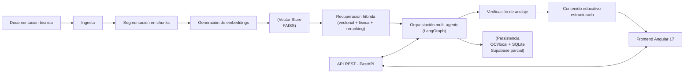

# NuevaMente — Sistema Inteligente de Adaptación y Generación de Contenido Educativo


**NuevaMente** transforma documentación técnica en materiales educativos claros y didácticos, permitiendo que los equipos aceleren el aprendizaje a partir del conocimiento técnico ya existente.

## Rutas de lectura rápida

- **Para estudiantes y primeros pasos:** Dirígete a la sección [4. Acceso al proyecto / Instalación](#4-acceso-al-proyecto--instalación) o consulta directamente el tutorial guiado en [docs/02-Instalacion/Uso_Local.md](docs/02-Instalacion/Uso_Local.md) para levantar el entorno en tu máquina paso a paso.
- **Para desarrolladores senior y evaluadores técnicos:** Revisa la [3. Arquitectura y tecnologías](#3-arquitectura-y-tecnologías) y la sección [7. Documentación detallada (Marco Diátaxis)](#7-documentación-detallada-marco-diátaxis) para examinar contratos de API, diseño RAG, cascada con fallback y almacenamiento.

## Índice

- [1. Descripción del proyecto](#1-descripción-del-proyecto)
- [2. Características principales](#2-características-principales)
- [3. Arquitectura y tecnologías](#3-arquitectura-y-tecnologías)
- [4. Acceso al proyecto / Instalación](#4-acceso-al-proyecto--instalación)
- [5. Uso](#5-uso)
- [6. Estructura del proyecto](#6-estructura-del-proyecto)
- [7. Documentación detallada (Marco Diátaxis)](#7-documentación-detallada-marco-diátaxis)
- [8. Próximos pasos o futuras implementaciones](#8-próximos-pasos-o-futuras-implementaciones)
- [9. Contribución](#9-contribución)
- [10. Licencia](#10-licencia)

## 1. Descripción del proyecto

**Problema:** Las organizaciones acumulan manuales, guías, especificaciones y otra documentación técnica extensa, pero este conocimiento suele ser difícil de asimilar para quienes están en proceso de formación u onboarding. Ese material, por su densidad y formato, queda infrautilizado.

**Solución:** NuevaMente toma esa documentación existente y la adapta a contenido educativo estructurado, ajustado al perfil y nivel de detalle, sin perder precisión ni fidelidad a la fuente.

**Valor:** Reduce el tiempo de aprendizaje, facilita la transferencia de conocimiento dentro del equipo y reutiliza activos técnicos ya existentes para generar material formativo útil y listo para aplicar.

**Público objetivo:** Equipos de formación, producto, desarrollo y documentación que necesitan convertir activos técnicos en materiales de aprendizaje para acelerar la adopción de tecnologías, herramientas o procesos.

**Enfoque actual:** El flujo se basa en **recuperación híbrida (vectorial + léxica) + adaptación con LLM**. Se obtiene contexto relevante mediante búsqueda semántica sobre FAISS combinada con recuperación léxica, se reordena con un reranker y un orquestador multi-agente de LangGraph genera el contenido. El sistema prioriza la fidelidad a las fuentes mediante un **mecanismo de anclaje** y cuenta con **cascada de proveedores con fallback** para mejorar su robustez.

**Más información:** [docs/01-Arquitectura/Arquitectura.md](docs/01-Arquitectura/Arquitectura.md)

## 2. Características principales

- **Adaptación educativa flexible:** Soporta múltiples formatos (Flashcards, Quiz, Tutorial, Resumen Ejecutivo, Guión de Clase) según el objetivo de aprendizaje.
- **Recuperación híbrida:** Búsqueda semántica sobre **FAISS** (local) combinada con recuperación léxica, más reranking opcional (Jina / Cohere) y control total sobre los datos.
- **Orquestación multi-agente:** Grafo LangGraph con etapas de planificación, generación, deduplicación, verificación de anclaje, crítica, reparación y formateo.
- **Anclaje de fuentes:** Cada elemento generado cita los fragmentos del documento que lo respaldan y se valida con dos revisores independientes. Ver [Anclaje de fuentes](docs/01-Arquitectura/Anclaje_de_Fuentes.md).
- **Adaptación guiada por prompts:** Prompts externos para ajustar tono, formato y nivel de detalle sin modificar el código.
- **Robustez con fallback:** Cascada de modelos con fallback entre proveedores (Gemini, Groq, OpenRouter), lo que permite mantener la disponibilidad ante errores o límites.
- **Exportación:** Descarga del material generado en PDF y como mazo de Anki (`.apkg`).
- **API REST organizada (FastAPI):** Endpoints claros para ingesta, recuperación, adaptación, almacenamiento y exportación.
- **Interfaz web (Angular 17):** UI principal para probar y visualizar el flujo completo.
- **Alternativa básica para pruebas rápidas (Gradio):** Incluye una interfaz ligera basada en **Gradio** para validar ingesta y generación sin levantar el frontend completo.

**Más información:** [docs/01-Arquitectura/Componentes.md](docs/01-Arquitectura/Componentes.md)

## 3. Arquitectura y tecnologías



- **Backend:** FastAPI (Python >= 3.11), gestionado con [uv](https://github.com/astral-sh/uv).
- **Frontend:** Angular 17 (standalone), servido con nginx.
- **Vector Store:** FAISS (local).
- **Embeddings:** Gemini, Jina y modelo local (`intfloat/multilingual-e5-base`).
- **LLM:** Google Gemini (modelo principal), con soporte para **cascada y fallback** entre proveedores.
- **Orquestación:** LangGraph con Multi-Agent.
- **Almacenamiento:** OCI Object Storage guarda documentos y artefactos; SQLite local guarda metadata, biblioteca y cola. Supabase está disponible como **modo parcial solo para documentos originales y su metadata**; no reemplaza por completo a OCI en el MVP.

**Más información:** [docs/01-Arquitectura/Tecnologias.md](docs/01-Arquitectura/Tecnologias.md)

## 4. Acceso al proyecto / Instalación

### Requisitos

- **Python 3.11 o superior** y [`uv`](https://github.com/astral-sh/uv).
- **Node.js 18+** y `npm` (para el frontend Angular).

### Pasos rápidos:

1. Clonar el repositorio.
2. Configurar el backend con `uv`.
3. Configurar el frontend con `npm`.
4. Crear `backend/.env` a partir de `backend/.env.example`.
5. Ejecutar backend y frontend.

> **Tutorial paso a paso para estudiantes:** Consulta [docs/02-Instalacion/Uso_Local.md](docs/02-Instalacion/Uso_Local.md) para la guía detallada con verificación de servicios, solución de problemas y comandos exactos.

### Puertos (`APP_PORT`)

El backend lee el puerto de la variable `APP_PORT` de `backend/.env` (por defecto **8001**). El frontend de desarrollo hace proxy a `http://127.0.0.1:8001`.

```bash
# backend/.env
APP_PORT=8001
```

- Si tienes **otra aplicación ocupando el 8000**, deja `APP_PORT=8001` y ejecuta el frontend con `npm start` (el proxy ya apunta ahí).
- Si prefieres usar el **8000**, cambia `APP_PORT=8000` y ajusta `frontend/proxy.conf.json` al mismo valor.
- En **Docker**, el backend se publica en el puerto `8000` del contenedor; el mapeo al host se define en `docker-compose.yml`.

## 5. Uso

- **Backend (desarrollo):** Desde `backend/`
  ```bash
  uv run --with email-validator --with genanki python main.py
  ```
  > `email-validator` y `genanki` se pasan con `--with` porque no están declarados en `pyproject.toml`. Arranca en `http://localhost:8001` (o el `APP_PORT` configurado).
- **Frontend (desarrollo):** Desde `frontend/`
  ```bash
  npm install && npm start  # http://localhost:4200
  ```
- **Alternativa básica para pruebas rápidas (Gradio):** Desde `backend/`
  ```bash
  uv run python ../frontend_gradio/app_gradio.py
  ```
  > `frontend_gradio/` es una **alternativa básica** (UI con Gradio) pensada para validaciones puntuales del flujo de ingesta/adaptación, sin necesidad de levantar la aplicación Angular completa. Importa los servicios del backend en el mismo proceso, no consume la API REST.

**Más información:** [docs/02-Instalacion/Uso_Local.md](docs/02-Instalacion/Uso_Local.md) | [docs/04-Documentacion/backend/ingestion/API_de_Ingesta.md](docs/04-Documentacion/backend/ingestion/API_de_Ingesta.md)

## 6. Estructura del proyecto

```text
nueva-mente/
├── backend/            # API FastAPI (Python >= 3.11)
│   ├── app/            # Núcleo: api/, core/, services/, prompts/, schemas/, infrastructure...
│   ├── migrations/     # Migraciones SQL (001+003 para Supabase parcial; no todas aplican)
│   ├── scripts/        # Scripts de apoyo y diagnóstico
│   ├── tests/          # Pruebas del backend (pytest) y scripts en tests/manual/
│   ├── Dockerfile      # Imagen del backend
│   └── requirements.txt
├── frontend/           # Aplicación Angular 17 (standalone). UI principal
├── frontend_gradio/    # UI alternativa básica (Gradio) para pruebas rápidas
├── data/               # Datos locales generados (índice FAISS, SQLite, almacenamiento)
├── docs/               # Documentación detallada del proyecto
├── docker-compose.yml  # Despliegue backend + frontend
├── LICENSE
├── .gitignore
└── .gitleaks.toml      # Configuración de detección de secretos
```

**Más información:** [docs/03-Estructura/Estructura_de_Archivos.md](docs/03-Estructura/Estructura_de_Archivos.md)

## 7. Documentación detallada (Marco Diátaxis)

La documentación técnica del proyecto se organiza bajo el sistema de 4 cuadrantes de documentación, adaptado para facilitar el recorrido tanto a perfiles que se inician como a perfiles senior:

### 1. Tutoriales (Orientados al aprendizaje práctico)
Paso a paso guiado para poner en marcha el proyecto desde cero:
- [Tutorial de Uso Local](docs/02-Instalacion/Uso_Local.md): Instalación de dependencias, configuración mínima y primera ejecución integral del sistema.

### 2. Guías Prácticas / How-To (Orientadas a tareas específicas)
Instrucciones paso a paso para resolver configuraciones puntuales y despliegue:
- [Despliegue con Docker y Docker Compose en OCI](docs/02-Instalacion/Despliegue_Docker_OCI.md): Despliegue contenerizado del frontend y backend en Compute VM.
- [Creación de Instancia en Oracle Cloud (OCI Always Free)](docs/02-Instalacion/Creacion_de_Instancia_OCI.md): Configuración de máquina virtual, VCN, seguridad e IP pública.
- [Configuración de LLMs y Proveedores](docs/02-Instalacion/Configuracion_de_LLMs.md): Credenciales de Gemini, Groq, OpenRouter y configuración de cascada.
- [Configuración de Almacenamiento](docs/02-Instalacion/Configuracion_de_Storages.md): Modos reales del MVP: OCI completo, Supabase parcial para documentos y almacenamiento local de desarrollo.

### 3. Referencia (Orientada a la información técnica precisa)
Especificaciones formales, contratos de datos y catálogos de componentes:
- [API REST de Ingesta](docs/04-Documentacion/backend/ingestion/API_de_Ingesta.md): Endpoints, payloads JSON, parámetros de consulta y códigos de respuesta.
- [Anclaje técnico](docs/04-Documentacion/backend/quality/Anclaje_Tecnico.md): Reglas de verificación, umbrales, cálculo del score y contrato de citas.
- [Estructura de Archivos del Repositorio](docs/03-Estructura/Estructura_de_Archivos.md): Árbol detallado de módulos, directorios y responsabilidades.
- [Almacenamiento en OCI Object Storage](docs/04-Documentacion/backend/storage/Almacenamiento_OCI.md): Métodos y cliente de integración con OCI.
- [Almacenamiento en Supabase](docs/04-Documentacion/backend/storage/Almacenamiento_Supabase.md): Modo parcial para documentos originales y metadata; alcance y limitaciones.
- [Frontend Angular](docs/04-Documentacion/frontend/Angular.md): Arquitectura de componentes, servicios y consumo de la API.
- [Frontend de Pruebas Gradio](docs/04-Documentacion/frontend/Gradio.md): Interfaz rápida para pruebas manuales.

### 4. Explicación (Orientada a la comprensión conceptual y arquitectura)
Análisis de diseño, fundamentos de las decisiones tomadas y flujo del sistema:
- [Arquitectura General del Sistema](docs/01-Arquitectura/Arquitectura.md): Filosofía de diseño, flujo RAG y modelo de fallback.
- [Componentes del Sistema](docs/01-Arquitectura/Componentes.md): Desglose funcional de subsistemas de ingesta, adaptación y entrega.
- [Tecnologías y Decisiones de Stack](docs/01-Arquitectura/Tecnologias.md): Justificación técnica de herramientas seleccionadas.
- [Anclaje de fuentes](docs/01-Arquitectura/Anclaje_de_Fuentes.md): Qué significa que el contenido esté respaldado por el documento, explicado sin código.
- [Arquitectura del Backend](docs/04-Documentacion/backend/architecture/Arquitectura_del_Backend.md): Capas del backend, inyección de dependencias y patrones aplicados.
- [Orquestación multi-agente (LangGraph)](docs/04-Documentacion/backend/architecture/Orquestacion_Multi_Agente.md): Nodos del grafo, router de proveedores, cobertura y bucles de auto-corrección.
- [Flujo de Servicios Backend](docs/04-Documentacion/backend/architecture/Flujo_de_Servicios.md): Secuencia completa desde la solicitud HTTP hasta la respuesta generada.
- [Ingesta y Segmentación (Chunking)](docs/04-Documentacion/backend/ingestion/Ingesta_y_Chunking.md): Criterios de fragmentación y preparación de documentos.
- [Generación de Embeddings](docs/04-Documentacion/backend/embeddings/Embeddings.md): Modelos de vectorización y consideraciones multilingües.
- [Almacén Vectorial FAISS](docs/04-Documentacion/backend/embeddings/Almacen_Vectorial.md): Indexación, métricas de distancia y persistencia vectorial.
- [Estrategia de Recuperación](docs/04-Documentacion/backend/retrieval/Recuperacion.md): Búsqueda semántica por similitud y umbrales de relevancia.
- [Reranking y Filtrado](docs/04-Documentacion/backend/retrieval/Reranking.md): Mecanismos de reordenamiento para optimizar el contexto entregado al LLM.

### 5. Roadmap y deuda técnica

- [Mejoras Post-MVP](docs/05-Roadmap/Mejoras_Post_MVP.md): Panel de configuración de almacenamiento, integración completa con Supabase, persistencia vectorial, migración de datos y adaptación del frontend.

## 8. Próximos pasos o futuras implementaciones

El MVP entrega OCI como backend completo y Supabase como modo parcial para documentos originales. Las siguientes capacidades están fuera del alcance actual y se detallan en [Mejoras Post-MVP](docs/05-Roadmap/Mejoras_Post_MVP.md):

- **Panel de configuración de almacenamiento:** elegir por tipo de dato dónde viven documentos originales, adaptaciones, metadata y vectores.
- **Integración completa con Supabase:** artefactos, biblioteca, papelera y autenticación sin depender de OCI ni SQLite.
- **Persistencia vectorial:** FAISS remoto o pgvector, con reindexación y migración.
- **Adaptación del frontend Angular:** usuarios UUID/Supabase Auth, biblioteca y papelera sobre el backend elegido.
- **Migración y operación:** scripts OCI/local → Supabase, verificación, rollback y observabilidad por backend.
- **Solicitud de temas o secciones específicas:** adaptar el contenido de un tema o sección concreta.

## 9. Contribución

Este proyecto se desarrolla de forma **interna por el Equipo 18 del G10** (No Country — Simulación G10 LATAM). Para mantener coherencia, calidad y trazabilidad, se recomienda seguir estas directrices:

**Equipo:**

| Nombre | Rol principal |
| :--- | :--- |
| Fernando Garcia | Project Lead |
| Miguel Benavides | Backend / Data Ingestion & Orchestration |
| Monica Escobar | Backend / Retrieval and Node Graph |
| Israel Mecillas | Frontend / Integration |
| Sebastian Gomez | QA / Testing |
| Fabian Cardenas | QA / Testing |
| Debora Aguilera | QA / Testing |

> Ajusta los roles según la contribución real de cada integrante.

**Directrices:**

- Trabajar sobre una rama propia (por ejemplo `feature/<tema>`) y abrir un Pull Request hacia la rama de integración.
- Escribir código y comentarios en inglés; la documentación y los prompts, en español.
- No subir secretos: `backend/.env` está excluido por `.gitignore` y hay un hook de `gitleaks` en `backend/scripts/pre-commit-gitleaks.sh`.

## 10. Licencia

Este proyecto se distribuye bajo la licencia **MIT**. Ver [LICENSE](LICENSE).
