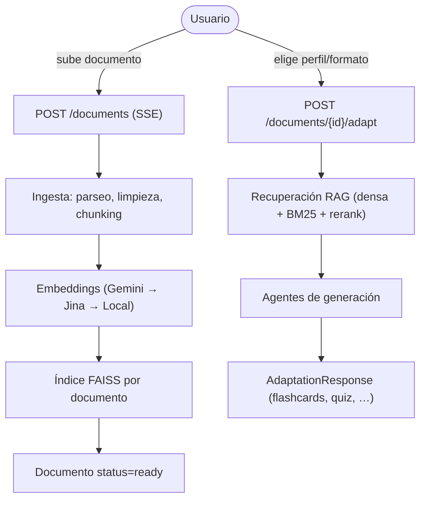

# Arquitectura

> `docs/01-Arquitectura/` · [Volver al README](../../README.md)

**NuevaMente** transforma documentación técnica en contenido educativo
(flashcards, quizzes, tutoriales…) adaptado a un perfil, formato y sector
elegidos. Este documento da la visión general del sistema; los detalles viven en
[Componentes](Componentes.md), [Tecnologías](Tecnologias.md) y en la sección
[04-Documentacion](../04-Documentacion/).

---

## 1. Visión general

El sistema sigue los principios de **Clean Architecture** y separación de
responsabilidades. Se organiza en capas desacopladas:

```text
┌───────────────────────────────────────────────────────────────┐
│ Presentación   · SPA Angular 17 (TypeScript)                  │
└───────────────────────────────┬───────────────────────────────┘
                                │ HTTP REST / SSE
                                ▼
┌──────────────────────────────────────────────────────────────┐
│ API REST (FastAPI) — ingestión, documentos, contenidos │
└──────────────────────────────────────────────────────────────┘
                               │
        ┌──────────────────────┴──────────────────────┐
        ▼                                             ▼
┌────────────────────────────┐        ┌───────────────────────────────┐
│ Pipeline RAG               │        │ Orquestación multi-agente      │
│ ingestión → embeddings →   │───────▶│ (LangGraph) + router de LLM    │
│ índice FAISS → recuperación│        │ redacta el contenido educativo │
└────────────────────────────┘        └───────────────────────────────┘
        │                                             │
        ▼                                             ▼
┌────────────────────────────┐        ┌───────────────────────────────┐
│ Índice vectorial (FAISS)   │        │ Almacenamiento (OCI/Supabase) │
└────────────────────────────┘        └───────────────────────────────┘
```

---

## 1. Flujo de extremo a extremo



1. **Ingesta** — el documento se sube, se guarda y se procesa. Ver
   [Ingesta y Chunking](../04-Documentacion/backend/ingestion/Ingesta_y_Chunking.md).
2. **Embeddings + índice** — los fragmentos se vectorizan y se indexan. Ver
   [Embeddings](../04-Documentacion/backend/embeddings/Embeddings.md) y
   [Almacén Vectorial](../04-Documentacion/backend/embeddings/Almacen_Vectorial.md).
3. **Recuperación** — se buscan los fragmentos más relevantes para el objetivo.
   Ver [Recuperación](../04-Documentacion/backend/retrieval/Recuperacion.md).
4. **Generación** — los agentes redactan el contenido educativo y se valida
   contra esquemas Pydantic.

---

## 2. Principios de diseño

- **Separación de responsabilidades:** endpoints, servicios, infraestructura y
  esquemas viven en capas distintas.
- **Interfaces de almacenamiento intercambiables:** el storage del documento
  original se elige por configuración (OCI, Supabase o local) detrás de la misma
  interfaz.
- **Tolerancia a fallos por cascada:** tanto los embeddings como los LLM y el
  reranker tienen proveedores de respaldo.
- **Un índice por documento:** la generación trabaja siempre sobre un único
  documento.

---

<div align="right">

[Volver al README](../../README.md)

</div>

