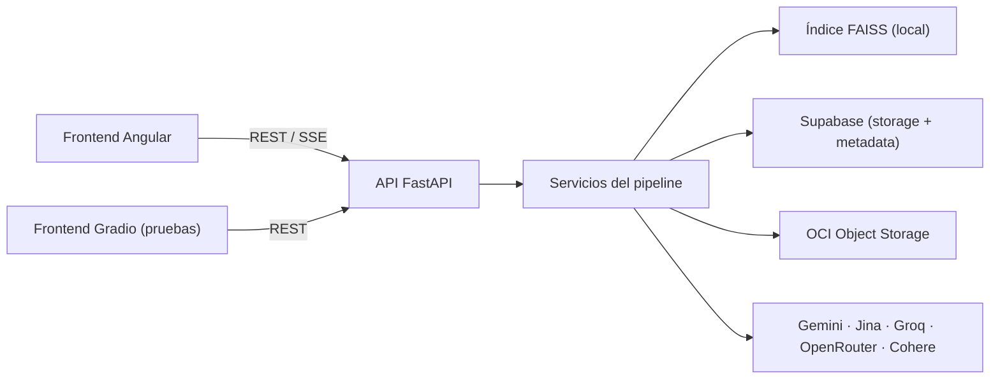

# Arquitectura del Backend

> `docs/04-Documentacion/backend/architecture/` · [Volver al README](../../../../README.md)

Este documento describe cómo está organizado el backend de NuevaMente: la capa
HTTP, los servicios del pipeline, los clientes de infraestructura y los
esquemas. El detalle de cada etapa vive en los archivos hermanos de
`04-Documentacion/backend/`.

---

## 1. Capas del backend

El backend sigue los principios de **Clean Architecture** y separación de
responsabilidades. El árbol de `backend/app/` es:

| Carpeta | Rol |
| :--- | :--- |
| `api/v1/endpoints/` | Superficie HTTP (routers FastAPI). No contiene lógica de negocio. |
| `services/` | Núcleo del proyecto: ingesta, embeddings, indexado, recuperación y orquestación. |
| `infrastructure/` | Clientes de servicios externos (Gemini, Jina, Groq, OpenRouter, Cohere, OCI, Supabase). |
| `schemas/` | Contratos Pydantic de entrada/salida (`adaptation`, `document_record`, `ingestion`, `rag_chunks`). |
| `core/` | Configuración central (`config.py`): modelos, límites y banderas de entorno. |
| `prompts/` | Plantillas de prompt (en español) que consumen los agentes. |
| `domain/` | Tipos y reglas de negocio puras, sin dependencias de infraestructura. |

El principio se repite en toda la app: **los endpoints no hablan con las APIs
externas ni con FAISS; los servicios tampoco conocen el HTTP**. Cada capa
depende solo de la interfaz de la capa inferior.

---

## 2. Superficie HTTP (`app/api/v1/endpoints/`)

`app/api/v1/api.py` compone el router v1; `main.py` lo monta bajo `/api/v1`
(y, por compatibilidad, también bajo `/api`, `/api/api/v1` y `/api/api`).

| Módulo | Responsabilidad |
| :--- | :--- |
| `documents.py` | Ingesta (`POST /documents`), listado/consulta de documentos y generación (`POST /documents/{id}/adapt`). Es el corazón funcional. |
| `contents.py` | Biblioteca de contenidos generados. |
| `health.py` | Estado del sistema. |
| `auth.py` | Autenticación de usuarios. |
| `anki.py` | Exportación de flashcards a Anki (`.apkg`). |
| `trash.py` | Papelera y borrado lógico. |
| `storage.py` | Operaciones sobre OCI Object Storage. |

---

## 2. Servicios del pipeline (`app/services/`)

Los servicios se agrupan por etapa de ejecución. Cada grupo se documenta en su
propio archivo de `04-Documentacion/backend/`.

| Etapa | Servicios | Documento |
| :--- | :--- | :--- |
| **1. Ingesta** | `document_pipeline_service`, `pdf_parser_service`, `text_cleaner`, `noise_filter_service`, `ingester_service`, `pdf_image_extractor`, `pdf_vision_service` | [Ingesta y Chunking](../ingestion/Ingesta_y_Chunking.md) |
| **2. Embeddings** | `embedding_service`, `embedding_rate_limiter` | [Embeddings](../embeddings/Embeddings.md) |
| **3. Indexación** | `vector_store_service` | [Almacén Vectorial](../embeddings/Almacen_Vectorial.md) |
| **4. Recuperación** | `retrieval_service`, `reranker_service` | [Recuperación](../retrieval/Recuperacion.md) · [Reranking](../retrieval/Reranking.md) |
| **5. Orquestación y salida** | `langgraph_orchestrator`, `multi_agent_router`, `coverage_planner`, `rate_guard`, `pdf_export_service` | este documento (§4) |

Servicios de soporte transversal:

- `document_storage_service` y `oci_storage_service`: mueven bytes del documento
  original y de los artefactos generados → [Storage](../storage/Almacenamiento_OCI.md).
- `document_repository`: metadata y estados del documento en Postgres/Supabase.
- `storage_queue_service`, `trash_service`: colas de subida y borrado lógico.

---

## 4. Orquestación multi-agente y generación

El contenido educativo se produce con **LangGraph** (`langgraph_orchestrator.py`)
sobre un router de proveedores (`multi_agent_router.py`):

1. **Recuperación de contexto** — `retrieval_service.retrieve_context()` devuelve
   los *parent chunks* más relevantes del documento.
2. **Planificación de cobertura** — `coverage_planner.py` decide qué conceptos
   debe cubrir el contenido.
3. **Generación** — los agentes redactan según el formato solicitado
   (flashcards, quiz, tutorial, …), con prompts en `app/prompts/`.
4. **Validación** — el resultado se valida contra los esquemas Pydantic
   (`AdaptationResponse`) antes de responder.

Los clientes de LLM viven en `app/infrastructure/` (`gemini_client`,
`groq_client`, `cohere_client`). El router elige el proveedor preferido por
formato y define una **cascada de respaldo** para tolerar caídas o cuotas
agotadas.

---

## 5. Componentes externos

---

[Volver al README](../../../../README.md)

